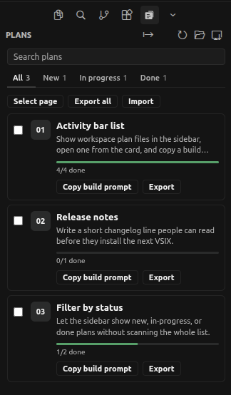

# Cursor Plans

[](https://github.com/UXCentury/cursor-plans/actions/workflows/ci.yml)



Cursor has no global list of workspace plans. New plans land in `~/.cursor/plans`. On Windows that folder is `C:\Users\<you>\.cursor\plans`, not a directory inside the repo. This extension lists that home folder and this project's `.cursor/plans`, and can move a home-folder plan in when you ask.

## What it does

- Adds a **Plans** item to the activity bar
- Lists `*.plan.md` files from the project's `.cursor/plans/` (falls back to `docs/plans/`)
- **Save to workspace** — if the open file is in `~/.cursor/plans`, moves that file; otherwise you pick one. It lands in `.cursor/plans/` so it can be committed and built
- Click a plan to open the markdown
- **Copy build prompt** — paste into a new Agent chat to run a workspace plan (uses the real `@` path)
- Refreshes when a plan file is added, changed, or deleted
- Filter the list: All, New, In progress, Done
- Search by name or overview; long lists paginate eight at a time
- **Export** / **Import** a `.cplan` bundle — all plans, one plan, or a selection, with progress

Optional frontmatter `group:` splits the list. Plans without it stay flat.

```yaml
group: Later
```

## Commands

| Command | What it does |
| --- | --- |
| Plans: Show sidebar | Opens the Plans activity-bar view |
| Plans: Refresh | Rescans workspace plan files |
| Plans: Reveal folder | Opens `README.md` in a plans folder, or reveals the folder |
| Plans: Save to workspace | Moves the open home-folder plan here, or lets you pick one |
| Plans: Export | Writes selected plans (or all) to a `.cplan` file |
| Plans: Import | Reads a `.cplan` file into `.cursor/plans/` |

## Developer

Built by **UXCentury** (UXC LLC), a design and engineering studio in Armenia, Yerevan.

- Website: [uxcentury.com](https://uxcentury.com)
- Source: [github.com/UXCentury/cursor-plans](https://github.com/UXCentury/cursor-plans)

`npm test` runs the parser checks. GitHub Actions runs that and packages the VSIX on every push.

## License

[MIT](LICENSE) — Copyright (c) 2026 UXCentury (UXC LLC).
